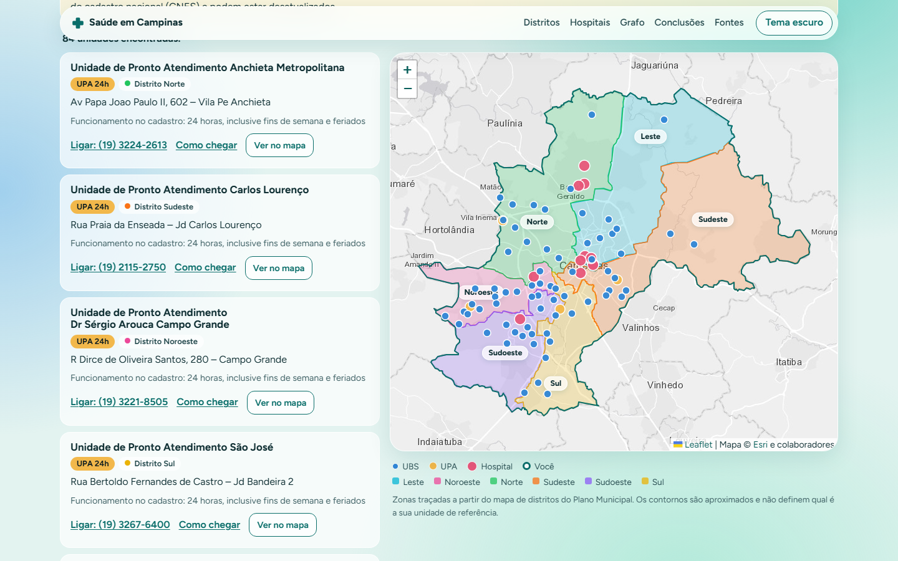

# Mapa de Acesso à Saúde Pública em Campinas

Encontre UBS, UPAs e hospitais do SUS em Campinas e compare os seis distritos de saúde da cidade.

**[Abrir o painel](https://arthur-cmarques1.github.io/mapa-saude-campinas/)**

Não precisa instalar nada. Você também pode baixar o arquivo [docs/index.html](docs/index.html) e abri-lo com dois cliques: ele funciona sem internet, só o mapa de ruas fica de fora.

> **Em emergência, ligue 192 (SAMU).** Este é um trabalho acadêmico, sem vínculo com a Prefeitura ou com o Ministério da Saúde. Telefones e horários vêm do cadastro nacional e podem estar desatualizados.


## O que dá para fazer

- Buscar uma unidade por nome, rua ou bairro, com ou sem acentos.
- Filtrar por tipo (UBS, UPA, hospital) e por distrito.
- Ver as unidades mais próximas pela sua localização ou por um ponto marcado no mapa. A localização não sai do seu aparelho.
- Ligar para a unidade e abrir a rota até ela.
- Ver as seis zonas de saúde no mapa, cada uma com sua cor, e destacar uma delas.
- Comparar os distritos em gráficos e em um quadro.
- Baixar os dados em CSV, prontos para o Excel.

O painel funciona em celular e computador, com tema claro ou escuro, por teclado e com leitor de tela. A lista de unidades e os quadros continuam disponíveis mesmo sem JavaScript.

## O que os dados mostram

Projeto Integrador da disciplina **Bancos de Dados Não Relacionais**, PUC-Campinas, 2026. A pergunta: a rede pública está distribuída de forma desigual entre os distritos?

| Distrito | Moradores | UBS | Equipes | Moradores por UBS | Cadastrados por equipe | Situação |
|---|---:|---:|---:|---:|---:|---|
| Sudoeste | 183.424 | 12 | 47 | 15.285 | 4.138 | Sobrecarga |
| Sul | 184.941 | 11 | 35 | 16.813 | 4.088 | Sobrecarga |
| Norte | 197.596 | 12 | 41 | 16.466 | 3.754 | Atenção |
| Sudeste | 185.853 | 9 | 35 | 20.650 | 3.742 | Atenção |
| Leste | 213.642 | 9 | 36 | 23.738 | 3.520 | Atenção |
| Noroeste | 173.591 | 16 | 46 | 10.849 | 3.492 | Dentro do parâmetro |

A política nacional recomenda de 2.000 a 3.500 pessoas por equipe. Os cortes da coluna "Situação" são escolha deste projeto, não uma classificação oficial.

A resposta depende da medida: contando todos os moradores por UBS, o Leste tem o maior número; contando quem está cadastrado por equipe, é o Sudoeste.

## Versão 2 (novembro de 2026)

Esta versão é uma atualização feita por Arthur Costa Marques depois da entrega do trabalho. A versão entregue pelo grupo continua disponível na tag [`v1.0`](https://github.com/arthur-cmarques1/mapa-saude-campinas/tree/v1.0).

**Os resultados mudaram.** A versão 1 apontava o Noroeste como crítico, com 87 mil moradores por UBS. Era um erro de método: com os dados oficiais, ele tem 10.849 e a menor carga da cidade. As principais correções:

- O distrito de cada unidade vem da tabela oficial do Plano Municipal, e não do texto do bairro.
- A população por distrito é a publicada no plano, e não uma estimativa. São 6 distritos, com o Sudeste.
- O parâmetro passou a ser o da portaria vigente, de 2.000 a 3.500 pessoas por equipe. A frase "1 UBS para cada 3 a 5 mil pessoas" não consta nela.
- Saíram do cálculo unidades desativadas, como hospitais de campanha da COVID, além de uma penitenciária e de uma UPA duplicada.
- O painel ganhou um localizador de unidades, passou a funcionar sem internet e ficou acessível no celular, por teclado e em dois temas.

## Fontes

| Dado | Fonte |
|---|---|
| Unidades, endereços, telefones, vínculo SUS | [CNES, API de dados abertos do Ministério da Saúde](https://apidadosabertos.saude.gov.br/), coletado em 05/11/2026 |
| Distritos, população por distrito e por UBS, cadastro, equipes | [Plano Municipal de Saúde de Campinas 2026-2029](https://portal-adm.campinas.sp.gov.br/sites/default/files/secretarias/arquivos-avulsos/125/2026/05/07-104042/PMS_2026-2029_Campinas_Matriz_Geral.pdf), com população do Censo 2022 |
| Total da população, para conferência | IBGE, SIDRA, tabela 4709 |
| Parâmetro por equipe | [Portaria GM/MS 2.436/2017 (PNAB)](https://bvsms.saude.gov.br/bvs/saudelegis/gm/2017/prt2436_22_09_2017.html) |
| Contorno das zonas | Mapa de distritos do Plano Municipal (imagem), encaixado na malha do IBGE |
| Limite do município | Malhas do IBGE |
| Mapa de ruas | Esri (Light Gray Canvas e World Street Map) |

## Limitações

Estas vêm das próprias fontes e não têm como ser removidas pelo projeto:

- As datas diferem: população de 2022, cadastro de dez/2024, equipes de nov/2024.
- O cadastro não é uma contagem exata: no Sudoeste, ele supera o Censo.
- Não há dependência do SUS por distrito, só o valor da cidade (60%).
- Filas, qualidade do atendimento e tempo de deslocamento não são medidos.
- A distância é em linha reta, e a unidade mais próxima pode não ser a de referência da pessoa.
- O plano publica o mapa de distritos só como imagem, então os contornos das zonas são aproximados. Das 79 unidades de distrito conhecido, 77 caem na zona certa, e as outras 2 ficam a até 100 m da fronteira. Hospitais fora das listas do plano recebem o distrito pela posição nesse mapa.
- O campo de vínculo SUS do CNES se refere ao atendimento ambulatorial. O CAISM/Unicamp consta como desabilitado no cadastro e está fora do localizador.

## Para desenvolvedores

Testado com Python 3.11 e 3.14 no Windows.

```bash
python -m venv .venv
.venv\Scripts\activate           # Linux/Mac: source .venv/bin/activate
pip install -r requirements.txt
python src/dashboard.py --abrir  # gera docs/index.html e abre no navegador
```

### Atualizar os dados

```bash
pip install -r requirements-dados.txt
python src/pipeline.py --coletar   # baixa o CNES, confere o IBGE e refaz data/
python src/dashboard.py
```

A coleta é validada antes de gravar: se uma UBS oficial sumir do cadastro, o processo para sem alterar os arquivos. Quando sair um novo plano municipal, atualize a referência com `scripts/extrair_referencia_sms.py` e as zonas com `scripts/extrair_zonas_distritos.py`.

### MongoDB Atlas (opcional)

Copie `.env.example` para `.env` e preencha `MONGO_URI`. O painel passa a ler do banco e volta aos arquivos locais, com aviso, se ele estiver inacessível ou desatualizado.

```bash
python src/pipeline.py --carregar-atlas --confirmar
```

A carga substitui as coleções `regioes`, `estabelecimentos`, `relacoes` e `metadados` do banco `saude_campinas`. Os dados entram em coleções temporárias, e as atuais só são trocadas depois que tudo foi inserido. Esse caminho foi testado com banco simulado (mongomock), ainda não em um Atlas real. Arquitetura e formato dos documentos em [docs/arquitetura.md](docs/arquitetura.md).

### Testes

```bash
pip install -r requirements-dev.txt
python -m playwright install chromium
python -m pytest
```

### Publicar

O GitHub Pages serve a pasta `docs/`. Basta enviar `docs/index.html` atualizado para a branch `main`.

## Imagens




## Autoria

**Versão 2:** Arthur Costa Marques.

**Versão original (v1.0), Projeto Integrador:** Arthur Costa Marques, Conrado Marques, Fábio Barbosa Gonsalez e Patrick Rovaron Franco. Docente: Joice Marin.

### Contribuições na versão original

| Etapa | Autoria |
|---|---|
| Coleta CNES/IBGE | Fábio Barbosa Gonsalez |
| Tratamento | Arthur Costa Marques |
| Modelagem MongoDB | Patrick Rovaron Franco |
| Carga no Atlas | desenvolvido em grupo |
| Leitura | desenvolvido em grupo |
| Dashboard / mapa | desenvolvido em grupo |
| Apresentação | desenvolvido em grupo |
| Reorganização do repositório para publicação | a definir |

## Licença

Código sob licença MIT, **proposta e pendente de confirmação do grupo** (ver [LICENSE](LICENSE)). Plotly.js e Leaflet são distribuídos em `src/vendor/` com as licenças originais. Os dados vêm de fontes públicas e devem ser citados conforme a seção de fontes.
