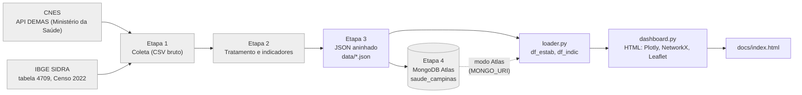

# Arquitetura do pipeline

Fluxo de dados do projeto, conforme o código preservado em `src/pipeline.py`
(etapas 1 a 4, registro histórico) e o fluxo atual em `src/loader.py` e
`src/dashboard.py`.

Nós em cinza: etapas históricas (1 a 4). Elas documentam como os dados foram
obtidos e carregados no Atlas, mas **não fazem parte do fluxo reproduzível**:
o fluxo reproduzível começa nos arquivos de `data/`. A Etapa 4 apaga
(`drop`) as coleções antes de recarregá-las e fica desativada por padrão.

## Etapas

| Etapa | O que faz (conforme o código) | Situação neste repositório |
|---|---|---|
| 1 | Pagina a API do CNES para o município (código 350950) e consulta o SIDRA 4709 para a população | Histórico, não executada aqui |
| 2 | Filtra UBS, hospitais e UPAs; mapeia bairro → 5 distritos de saúde; valida coordenadas (bounding box); remove duplicatas; estima a população por distrito; calcula hab/UBS | Histórico, não executada aqui |
| 3 | Converte as tabelas em documentos JSON aninhados (`regioes`, `estabelecimentos`, `relacoes`) | Resultado versionado em `data/` |
| 4 | Carrega as 3 coleções no MongoDB Atlas e cria índices | Histórico; desativada por padrão |
| Leitura | Reconstrói `df_estab` e `df_indic` a partir de `data/*.json` ou do Atlas | `src/loader.py` |
| Dashboard | Gera o HTML com gráficos Plotly, grafo NetworkX e mapa Leaflet | `src/dashboard.py` |

## Coleções (formato dos documentos)

- `regioes`: 5 documentos (um por distrito de saúde), com população estimada,
  centroide (GeoJSON), contagem de unidades e indicadores.
- `estabelecimentos`: 115 documentos, com tipo, endereço (bairro e região),
  localização (GeoJSON), vínculo SUS e natureza.
- `relacoes`: 115 documentos auxiliares (região → estabelecimento).
