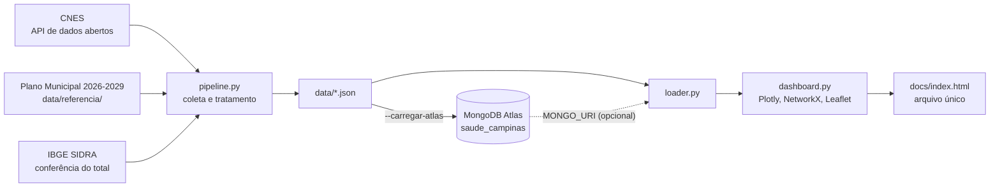

# Arquitetura

## Módulos

| Arquivo | Função |
|---|---|
| `src/pipeline.py` | Coleta o CNES, trata, valida, grava `data/` e carrega no MongoDB |
| `src/indicadores.py` | Regras dos indicadores e dos níveis de pressão |
| `src/loader.py` | Lê `data/` ou o MongoDB e monta os DataFrames |
| `src/dashboard.py` | Monta os gráficos e o HTML |
| `src/template/` | HTML, CSS e JavaScript do painel |
| `src/vendor/` | Plotly.js 4.1.1 (versão básica) e Leaflet 1.9.4, embutidos no HTML |
| `scripts/extrair_referencia_sms.py` | Extrai a tabela oficial do PDF e confere contra os totais publicados |

## Como o distrito de cada unidade é definido

O campo `endereco.regiao_origem` registra qual destes critérios foi usado:

1. **Tabela oficial de UBS:** código CNES na tabela do Plano Municipal.
2. **Serviços do distrito no plano municipal:** hospitais e UPAs citados na seção de cada distrito.
3. **UBS mais próxima:** para os demais hospitais. O critério é medido a cada execução nas unidades de distrito conhecido e o resultado fica em `metadados.criterio_ubs_mais_proxima` (hoje, 10 de 10).

## Regras de exclusão

Cada registro excluído fica em `data/excluidos.json`, com o motivo:

- desabilitado no CNES (`codigo_motivo_desabilitacao_estabelecimento` preenchido);
- sem coordenadas;
- tipo UBS fora da lista oficial da Secretaria de Saúde;
- pronto atendimento sem vínculo SUS.

## Indicadores

| Indicador | Conta |
|---|---|
| `hab_por_ubs` | população do distrito ÷ UBS |
| `hab_por_equipe` | população do distrito ÷ equipes de Saúde da Família |
| `cadastrados_por_equipe` | população cadastrada ÷ equipes, só nas unidades com cadastro publicado |
| `pressao` | `cadastrados_por_equipe` ÷ 3.500 × 100 |
| `nivel` | até 100, dentro do parâmetro; até 115, atenção; até 130, sobrecarga; acima, crítico (cortes do projeto) |

## Coleções

- `regioes` (6): população, centroide das UBS (GeoJSON), contagem de unidades e indicadores.
- `estabelecimentos` (99): tipo, endereço, origem do distrito, localização (GeoJSON), telefone, turno, vínculo SUS, natureza jurídica e, nas UBS, equipes e população.
- `relacoes` (99): distrito e estabelecimento, usada no grafo.
- `metadados` (1): data da coleta, fontes e versão do formato.

Índices: 2 geoespaciais (`2dsphere`), 1 de texto e 4 comuns. O painel recusa um banco com `versao_esquema` diferente da esperada e usa os arquivos locais.
